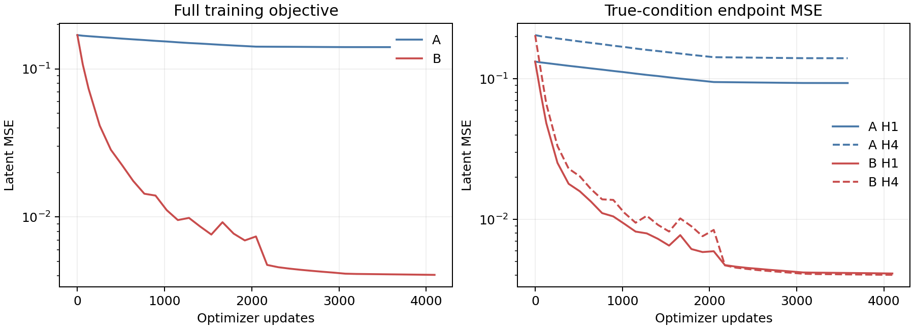

# Phase 1 oracle capacity training

This is a supervised offline capacity diagnostic on the same 62 usable G3 trajectories. It does not train PRBD belief updates or authorize Phase 2.

The collector's fixed RNG(20261120) speed permutation is checked against stored physical metadata. Slow 2.5 maps to branch 1 and fast 7.5 to branch 2. Branch 0 is the literal frozen host. Branch 3 receives both conditions' same true targets with pooled supervision; it has equal total loss weight to the labeled branches together and is retained as an ordinary fourth branch. Oracle readout uses branches 1/2. There is no null-control reference.

All 682 actual roots with a complete H4 suffix are used. For every root, H1 and freely rolled H4 endpoint latent MSE receive weights 1/2 each; the true-condition branch and pooled branch 3 also receive weights 1/2 each. No likelihood, noise, XY readout, development outcome, or future beyond the actual training target enters the objective.

A trains exactly the original 3×6×192 = 3,456 condition offsets. B retains these and adds a rank-4 map from the latest native action condition to each condition/layer's offset, plus the jointly trained last two native blocks shared by all conditions. B computes F0 + [G(k) − G(0)] and returns literal F0 for branch 0. Its 3,614,848 trainable parameters comprise 3,456 offsets, 14,592 bilinear parameters, and 3,596,800 last-block parameters.

Both arms use the same initialization, ordered training data, sampled batches of 16 roots, Adam at 3e−4, and preset 10× learning-rate reductions at updates 2048 and 3072. The predeclared limit is 4096 updates. At or after 3072 updates, a nonnegative full-training-objective decrease of at most 0.1% over 512 updates stops training. The final state is retained; development data do not select checkpoints.

| Arm | Updates | Seconds | Early62 objective | Final objective | Oracle H1 | Oracle H4 | Last512 decrease | Converged by preset rule |
|---|---:|---:|---:|---:|---:|---:|---:|---|
| A | 3584 | 218.64 | 0.16731386 | 0.14015795 | 0.09351730 | 0.14047021 | 0.03680% | True |
| B | 4096 | 566.74 | 0.10696822 | 0.00406654 | 0.00412113 | 0.00402957 | 0.82606% | False |

This stopping result describes convergence under the preset optimization schedule. It does not prove a global optimum or an absolute capacity limit. The A/B contrast tests their combined response families; it does not separately identify the contribution of the bilinear map and last-two-block training. Generalization and physical action-effect recovery belong to the separate fixed-checkpoint evaluation.

CPU unit checks reproduce A's original unanchored path exactly, confirm B contains A at initialization, verify nominal H1–H4 bitwise equality after changing shared G weights, and establish nonzero pooled-branch gradients from both physical conditions. Training checks verify finite native gradients and the selected-branch API. CUDA is used for training; fixed milestone training trajectories are exported on CPU.

The published per-arm folders retain the written protocol, every minibatch loss, full-training objective every 128 updates plus update 62, and both final checkpoints. The A update-62 checkpoint is included for the early-capacity test. No hyperparameter or checkpoint search used evaluation scores.

